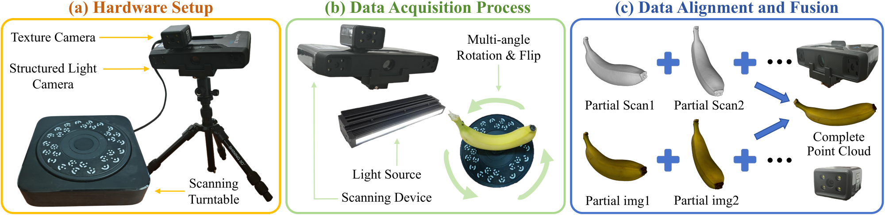
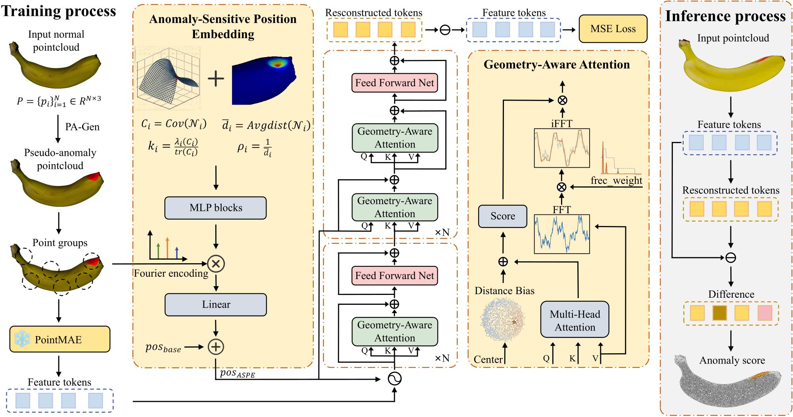
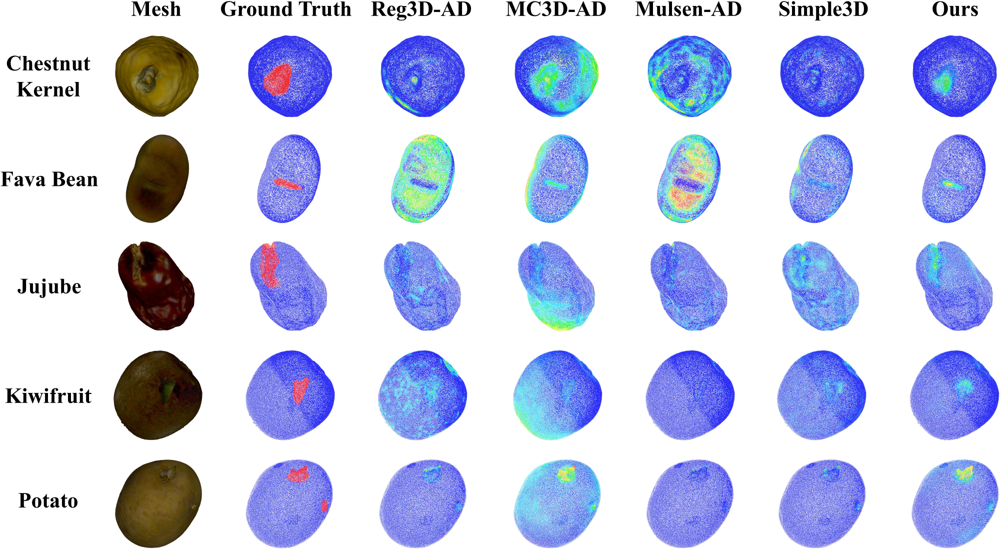

# Nature3D-AD: Geometry-Aware Feature Learning for Natural-Growth 3D Anomaly Detection

<p align="center">
  <a href="#-news"></a>
  <a href="#%EF%B8%8F-installation"></a>
  <a href="#%EF%B8%8F-installation"></a>
  <a href="LICENSE"></a>
</p>

Official repository for the NeurIPS 2026 paper **"Nature3D-AD: Geometry-Aware Feature Learning for Natural-Growth 3D Anomaly Detection"**.

Existing point cloud anomaly detection benchmarks target industrial parts with standard shapes. Agricultural products grow naturally, so their shape, size and texture vary widely and "normal" is much harder to define. To fill this gap, we build **NaturalGrowth**, the first point cloud anomaly detection benchmark for agricultural products, and propose **GESA**, which injects geometric priors into both the position embedding and the attention mechanism.

## 📢 News
- **[2026-10]** Code and benchmark meta files are released.
- **[2026-09]** Our paper is accepted by *NeurIPS 2026*.

## 💡 Key Innovations

1. **NaturalGrowth Benchmark**: 31 categories of common agricultural products with 1,477 real scans captured by an industrial structured-light scanner, covering natural defects (wormholes, rot) and physical damage (bruises, breakage).
2. **Anomaly-Sensitive Position Embedding (ASPE)**: local curvature and density are fused into a Fourier position embedding, so potentially anomalous regions get a stronger positional signal.
3. **Geometry-Aware Attention (GAA)**: distance and normal-similarity biases are added to the attention scores, together with an FFT spectral branch that strengthens local structure modeling.

All results are obtained with a **single unified model per dataset** (multi-category setting).

### Data Acquisition

<p align="center">
  
</p>


## 📂 Datasets

Our method is evaluated on the following benchmarks:
- **NaturalGrowth** (ours, 31 agricultural categories)
- **Real3D-AD** ([official repo](https://github.com/M-3LAB/Real3D-AD))
- **Anomaly-ShapeNet** ([HuggingFace](https://huggingface.co/datasets/Chopper233/Anomaly-ShapeNet), use `Anomaly-ShapeNet-v2/dataset/{pcd,obj}`)

Please organize the datasets as follows:

```
Nature3D-AD/
├── data/
│   ├── NaturalGrowth/
│   │   ├── train.json / test.json
│   │   ├── pcd/
│   │   │   ├── almonds/
│   │   │   │   ├── train/almondstemplate0.pcd ...
│   │   │   │   ├── test/almondspositive0.pcd, almondscut0.pcd ...
│   │   │   │   └── GT/almondscut0.txt ...        # x y z R G B label
│   │   │   └── ...                               # 31 categories
│   │   └── obj/
│   │       ├── almonds/almondstemplate0.obj ...  # meshes for training normals
│   │       └── ...
│   ├── Real3D-AD/
│   │   ├── train.json / test.json
│   │   ├── Real3D-AD-PCD/
│   │   │   ├── airplane/
│   │   │   │   ├── train/128_template.pcd ...
│   │   │   │   ├── test/142_good.pcd, 363_bulge.pcd ...
│   │   │   │   └── gt/363_bulge.txt ...          # x y z label
│   │   │   └── ...                               # 12 categories
│   │   ├── Real3D-AD-PLY/
│   │   │   ├── airplane/128_template.ply ...     # meshes for training normals
│   │   │   └── ...
│   │   └── real3D_down/                          # generated by tools/downsample_real3d.py
│   └── Anomaly-ShapeNet/
│       ├── train.json / test.json
│       ├── pcd/
│       │   ├── ashtray0/
│       │   │   ├── train/ashtray0_template0.pcd ...
│       │   │   ├── test/ashtray0_positive0.pcd, ashtray0_bulge0.pcd ...
│       │   │   └── GT/ashtray0_bulge0.txt ...    # x,y,z,label
│       │   └── ...                               # 40 categories
│       └── obj/
│           ├── ashtray0/ashtray0_template0.obj ...
│           └── ...
└── pretrain_ckp/
    └── modelnet_8k.pth
```

Notes:
- In test folders, files containing `positive` / `good` are normal samples; the others are defective.
- During training, normals are read from the meshes, so `pcd/` and `obj/` (or `Real3D-AD-PCD/` and `Real3D-AD-PLY/`) must be siblings.
- Real3D-AD training templates are very dense; downsample them with FPS (max 150k points) first:

### Framework

<p align="center">
  
</p>


```bash
python tools/downsample_real3d.py --real3d_path data/Real3D-AD/Real3D-AD-PCD
# -> data/Real3D-AD/real3D_down
```

## 🛠️ Installation

```bash
git clone https://github.com/NingxiaoJian/Nature3D-AD.git
cd Nature3D-AD
```

```bash
conda create -n nature3d python=3.10 -y
conda activate nature3d
# PyTorch with CUDA 12.4
pip install torch==2.4.0 torchvision==0.19.0 --index-url https://download.pytorch.org/whl/cu124
# Other dependencies
pip install -r requirements.txt
pip install "git+https://github.com/erikwijmans/Pointnet2_PyTorch.git#egg=pointnet2_ops&subdirectory=pointnet2_ops_lib"
```

Download the Point-MAE backbone pre-trained on ModelNet40-8K ([modelnet_8k.pth](https://github.com/Pang-Yatian/Point-MAE/releases/download/main/modelnet_8k.pth)) and put it at `pretrain_ckp/modelnet_8k.pth`.

## 🚀 Training

Each dataset has its own folder under `experiments/` with `config.yaml`, `train.sh` and `eval.sh`. Arguments: `<num_gpus> <gpu_ids>`; all experiments in the paper use a single GPU.

**NaturalGrowth:**
```bash
sh experiments/NaturalGrowth/train.sh 1 0
```

**Real3D-AD:**
```bash
sh experiments/Real3D-AD/train.sh 1 0
```

**Anomaly-ShapeNet:**
```bash
sh experiments/Anomaly-ShapeNet/train.sh 1 0
```

Checkpoints are saved to `experiments/<dataset>/checkpoints/` (`ckpt_best.pth.tar` is selected by `evaluator.key_metric`), logs and TensorBoard events to `experiments/<dataset>/log/`.

## 📊 Evaluation

**NaturalGrowth:**
```bash
sh experiments/NaturalGrowth/eval.sh 1 0
```

**Real3D-AD:**
```bash
sh experiments/Real3D-AD/eval.sh 1 0
```

**Anomaly-ShapeNet:**
```bash
sh experiments/Anomaly-ShapeNet/eval.sh 1 0
```

`eval.sh` loads `saver.load_path` in `config.yaml` (default `weights/ckpt_best.pth.tar`). To evaluate your own run, set it to `checkpoints/ckpt_best.pth.tar`. The script reports per-category and mean **O-AUROC / O-AUPR** (object level) and **P-AUROC / P-AUPR** (point level).

### Visualization

<p align="center">
  
</p>


## 📄 Citation
```bibtex
@inproceedings{ning2026nature3dad,
  title     = {Nature3D-AD: Geometry-Aware Feature Learning for Natural-Growth 3D Anomaly Detection},
  author    = {Ning, Jian and others},
  booktitle = {Advances in Neural Information Processing Systems (NeurIPS)},
  year      = {2026}
}
```

## 🙏 Acknowledgements

We thank the authors of the following works for making their code publicly available. Our implementation is built upon their excellent codebases:

- [UniAD](https://github.com/zhiyuanyou/UniAD)
- [MC3D-AD](https://github.com/iCAN-SZU/MC3D-AD)
- [PO3AD](https://github.com/yjnanan/PO3AD)
- [Point-MAE](https://github.com/Pang-Yatian/Point-MAE)
- [Real3D-AD](https://github.com/M-3LAB/Real3D-AD)

## 📜 License

This project is licensed under the Apache License 2.0 - see the [LICENSE](LICENSE) file for details.
